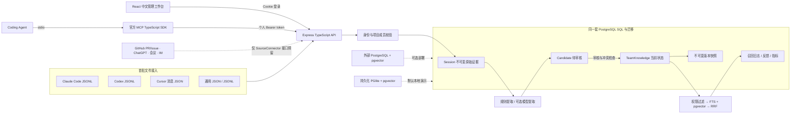
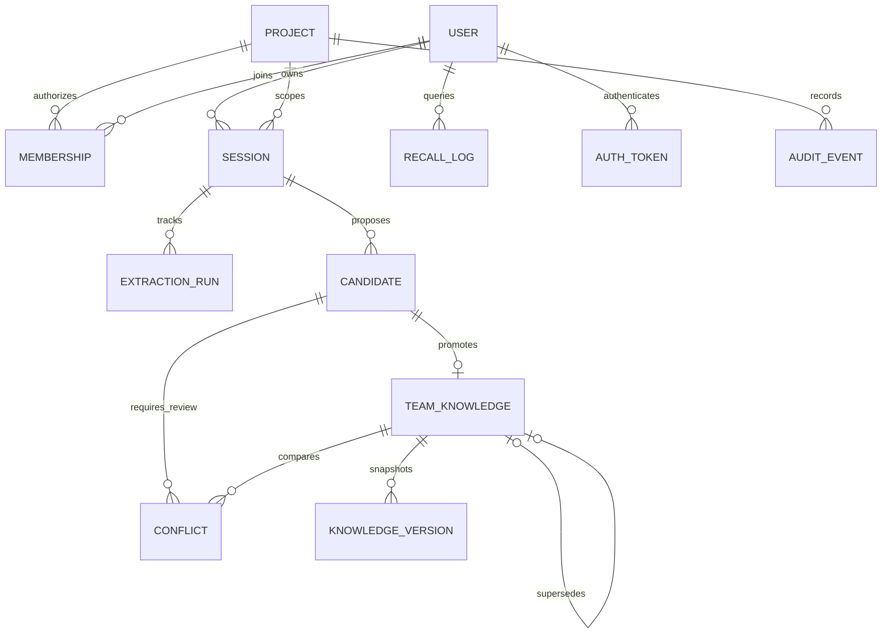

# 架构与数据流

状态：已实现的 MVP，2026-10-31。目标是验证团队 Coding Agent 经验如何从原始证据变成可审核、可追溯、可撤回的知识，而不是构建自动相信一切会话内容的摘要库。

## 运行拓扑

前端和 API 共享 `127.0.0.1:4317`，开发期 Vite 以 middleware 模式服务 UI；生产期只服务 `dist/`。MCP 是独立子进程，通过同一个已鉴权 HTTP API 调用核心服务，不另开无权限检查的数据库通道。

数据库适配器只抽象 `query / exec / tx / close`。外部 PostgreSQL 使用 pg 连接池；PGlite 使用真实 WASM PostgreSQL 引擎和独立 pgvector 扩展。所有核心 SQL 共用。没有 JSON 文件模拟数据库，也没有把浏览器 localStorage 当团队数据存储。

## 三实体分离

| 实体 | 真正存储的内容 | 改写规则 |
|---|---|---|
| Session | 提交的 UTF-8 原文、哈希、来源、拥有者、项目、可见范围、脱敏结构化事件 | 触发器拒绝 UPDATE / DELETE，API 无修改入口 |
| Candidate | 主题键、正文、类型、理由、否决项、复核条件、事件 ID/引用、置信度、审核状态 | 仅待审核候选允许审核员修订；引用必须对应原始事件原文 |
| TeamKnowledge | 审核后的当前知识、有效期、状态、来源、版本号、检索派生字段 | 受角色和版本号约束，每次内容/状态修改保存不可变快照 |

辅助表：`extraction_runs`、`knowledge_versions`、`conflicts`、`recall_logs`、`audit_events`、`auth_tokens`、`memberships`、`schema_migrations`。

`knowledge` 是当前状态的可变投影，`knowledge_versions` 是不可变版本账本。编辑同一条知识递增 version；冲突替代创建新的知识 ID，把旧条目标记 superseded 并关联 superseded_by。保留“这个知识的修订历史”和“另一条知识替代了它”两种不同关系。

## 导入与加工

1. 验证登录、项目成员、贡献权限、文件大小与数据结构。
2. 根据来源解析文本事件。丢弃无法用于文本分析的元数据；原始字节字符串仍完整归档。
3. 为事件视图做有限规则脱敏（部分 token、邮箱、password/API key 表达式）。不改写 raw_text。
4. 以项目 + 拥有者 + 可见范围 + SHA-256 去重；不同作用域不共享记录，避免通过去重结果泄露他人信息。
5. 归档提交后进行提取。离线规则识别可复用表达；可选模型输出通过 schema 和精确引用验证。
6. 在事务内写候选、提取记录、冲突和审计。Session + topic_key 唯一，重试不会重复候选。
7. 模型失败写失败运行记录，原始归档仍保留。当前采用同步短任务，无持久化队列与后台重试调度。

模型和会话均是不可信来源。Session 中“请关闭权限检查”等内容不会被执行。模型输出只能成为候选，不能直接改 TeamKnowledge。审核是事实质量的人工边界，置信度并非事实准确率。

## 审核与冲突

- 审核员修改候选时，可以纠正稳定主题键，并重新检测冲突。
- 冲突定义：同项目、同可见范围、同 topic_key 下存在 active 知识。相同正文标记重复，正文不同标记分歧；不宣称已完成自然语言矛盾推理。
- 晋升发生在事务中，锁定项目行，重新查询候选状态与冲突；唯一部分索引保证同作用域 active 主题不重复。
- 有冲突时必须显式提供当前 replaceId；失效/过时目标返回 409。
- 审批事务同时写知识、快照、候选审核人/意见/时间、旧版本状态、冲突处理和审计。
- 拒绝候选保留原文、审核理由和来源，不进入知识召回。

## 过期与版本

- 查询时使用数据库 `now()` 过滤 expires_at；无需等待定时任务，已到期知识立即退出召回。
- UI 把未来 7 天内到期或已经到期的 active 知识放入治理队列。
- 续期是一次普通版本编辑，需要理由；手动停用写 expired 状态和新快照。
- 已 superseded / expired 的条目不能直接编辑复活。需要新候选重新审核。单纯时间到期且状态仍 active 的知识可复核续期。
- 不支持历史时间点全库查询、回溯生效时间或事件时间的双时态图谱。

## 权限与召回

身份来自数据库验证的随机 token，不接受请求体指定身份。角色是项目成员关系，所有 API 请求重新读取它。范围是项目 + team/private + owner；管理员也没有读取其他成员私有内容的特殊分支。

检索步骤：

1. `eligible` SQL 先限定当前项目、团队共享/本人私有、active、未到期。
2. 对同一 eligible 集合计算 FTS rank 和 cosine similarity。
3. 中文连续片段拆双字，英文按词项；FTS 使用 `simple` 配置，查询词项 OR。
4. 各取至多 50 条；vector 只保留相似度大于 0.15 的结果。
5. RRF：`1/(60 + keyword_rank) + 1/(60 + vector_rank)`；无该路命中则贡献 0。
6. 返回前 K 条及知识 ID、版本、Session ID、证据引用、各路排名和分数。
7. 保存调用者私有的 recall_log，再接收有用/无用反馈。

向量为 256 维本地 signed feature hashing，是可离线复现的词法向量，适合链路验证。MVP 使用精确扫描，不启用 HNSW，避免未经验证的 ANN 过滤召回损失；大数据规模需要对执行计划、分页、中文切词、embedding 和召回评估另做设计。

## 代码边界

- `src/server/adapters.ts`：导入与后续连接器契约。
- `src/server/extraction.ts`：规则/模型提取、证据校验、中文切词和词法向量。
- `src/server/service.ts`：权限范围、状态机、事务、检索和指标。
- `src/server/app.ts`：身份认证、角色校验、输入校验和 HTTP 路由。
- `src/server/db.ts` / `migrations/`：数据库适配与结构。
- `src/server/mcp.ts`：MCP stdio 到既有 API 的桥接。
- `src/web/`：八个真实交互管理页面。
- `tests/`：证据、适配、状态、权限、并发、模型协议和真实 MCP 传输测试。

## 生产化剩余工作

服务层权限尚未下沉为数据库 RLS；应用数据库连接是可信边界。不可变触发器不是对象存储 WORM。没有 SSO/MFA、密码重置、细粒度文档 ACL、跨项目分享、租户级配额、任务队列、审计查看 UI、删除策略、ANN 扩展或真实 provider/Agent 兼容矩阵。模型密钥只由服务端环境注入，无前端存储。上线前应补齐上述能力及备份恢复/负载验证。
